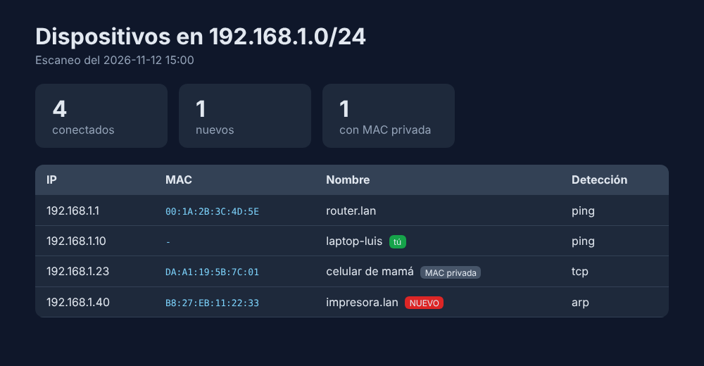

# 📡 escaner-de-red

[](https://github.com/luiss-devON/escaner-de-red/actions/workflows/tests.yml)


¿Quién está conectado a tu WiFi? Este programa **descubre todos los dispositivos de tu red local**, revisa qué **puertos tienen abiertos** y te **avisa cuando aparece un dispositivo nuevo** (por ejemplo, un vecino usando tu internet).

No necesita permisos de administrador ni instalar nada extra: solo Python.



## ✨ Características

- **Descubrimiento de dispositivos**: ping en paralelo + sondeo TCP + tabla ARP, para encontrar también equipos que bloquean el ping.
- **IP, MAC y nombre** de cada equipo; marca las **MAC privadas** (celulares y tablets).
- **Alertas de intrusos**: recuerda los dispositivos conocidos y avisa de los nuevos y de los que se desconectan.
- **Modo vigilancia**: escanea cada X minutos y suena una alerta si entra alguien nuevo.
- **Escáner de puertos** con nombre del servicio y **avisos de seguridad** (Telnet, FTP, RDP, VNC, bases de datos sin contraseña…).
- **Alias**: ponle nombre a tus equipos ("tele de la sala", "celular de mamá").
- **Reportes** en HTML, JSON y CSV.
- Escaneo multihilo: una red /24 completa en segundos.
- Funciona en **Windows y Linux**, con pruebas automáticas en ambos.

## 📦 Instalación

```bash
git clone https://github.com/luiss-devON/escaner-de-red.git
cd escaner-de-red
pip install .
```

## 🚀 Uso

```bash
escaner info                                  # tu IP y la red que se va a escanear
escaner descubrir                             # dispositivos conectados
escaner descubrir --html reporte.html         # además, guardar reporte visual
escaner descubrir --red 192.168.0.0/24 --csv equipos.csv

escaner puertos 192.168.1.1                   # puertos comunes del router
escaner puertos 192.168.1.40 --puertos 1-1024

escaner nombrar 192.168.1.23 "celular de mamá"
escaner dispositivos                          # todos los vistos alguna vez
escaner vigilar --cada 300                    # avisa de intrusos cada 5 minutos
```

Ejemplo de `escaner descubrir`:

```text
4 dispositivos en 192.168.1.0/24

IP            MAC                  NOMBRE                     DETECCIÓN
───────────────────────────────────────────────────────────────────────
192.168.1.1   00:1A:2B:3C:4D:5E    router.lan                 ping
192.168.1.10  -                    laptop-luis (este equipo)  ping
192.168.1.23  DA:A1:19:5B:7C:01 *  celular de mamá            tcp
192.168.1.40  B8:27:EB:11:22:33    impresora.lan              arp

* MAC privada/aleatoria (normalmente un celular o tablet).
⚠️  NUEVO dispositivo: 192.168.1.40  B8:27:EB:11:22:33  impresora.lan
```

Ejemplo de `escaner puertos`:

```text
     22/tcp  abierto  SSH
     23/tcp  abierto  Telnet
         ⚠️  Telnet envía todo sin cifrar; desactívalo y usa SSH.
     80/tcp  abierto  HTTP
```

### ¿Dónde se guarda el historial?

En `~/.escaner-red/dispositivos.json`. Puedes cambiarlo con `--datos archivo.json` o la variable de entorno `ESCANER_DATOS`.

## ⚙️ Cómo funciona

1. Calcula tu red local a partir de tu IP (por defecto una /24).
2. Hace ping a todas las direcciones en paralelo. En Windows solo cuenta como vivo un equipo que responde con `TTL`, porque `ping` devuelve éxito incluso con "host inaccesible".
3. A los que no responden les intenta abrir conexiones TCP: si el equipo acepta **o rechaza** la conexión, existe.
4. Lee la tabla ARP del sistema para obtener las MAC y encontrar equipos que bloquean todo.
5. Compara con el historial para detectar dispositivos nuevos.

## ⚖️ Uso responsable

Escanea **solo redes que sean tuyas o en las que tengas permiso**. Escanear redes ajenas puede ser ilegal.

## 🧪 Tests

```bash
python -m unittest -v
```

## 🗂️ Estructura

```text
src/escaner/
├── red.py             # IP local, redes, MAC y lectura de la tabla ARP
├── descubrimiento.py  # ping, sondeo TCP y descubrimiento multihilo
├── puertos.py         # escaneo de puertos, servicios y avisos de seguridad
├── historial.py       # dispositivos conocidos, nuevos y alias (JSON)
├── reporte.py         # tabla, HTML, JSON y CSV
└── cli.py             # interfaz de línea de comandos (argparse)
tests/                 # 25 tests con unittest
```

## 📄 Licencia

MIT

---

Hecho por **Luis José Castro Palacios**.
